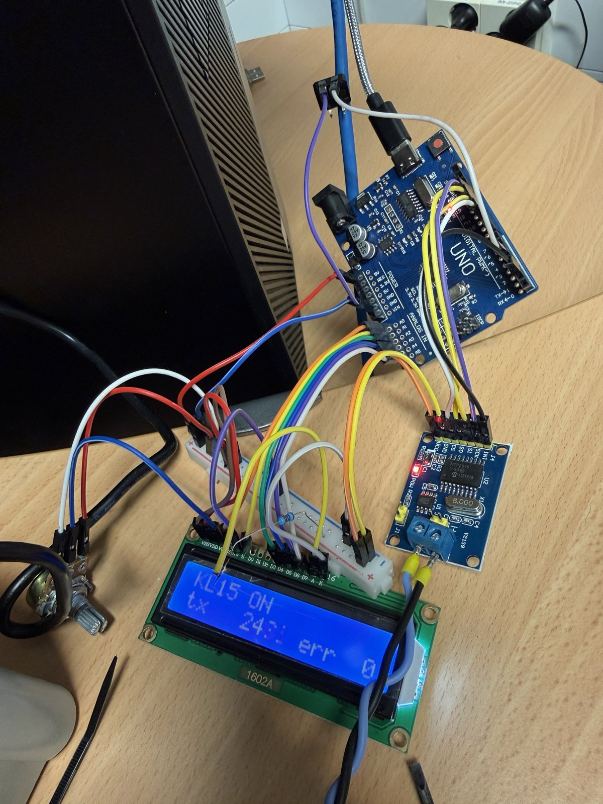
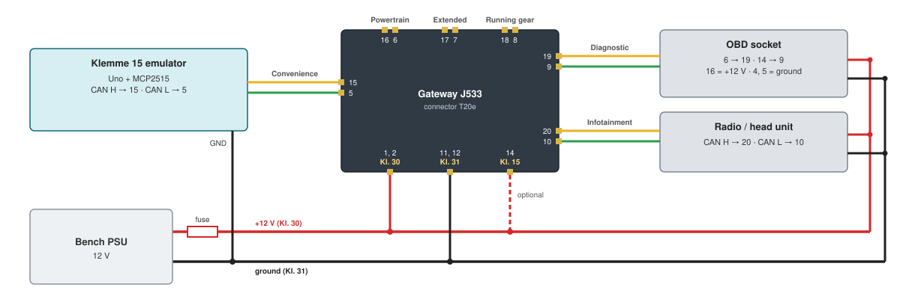
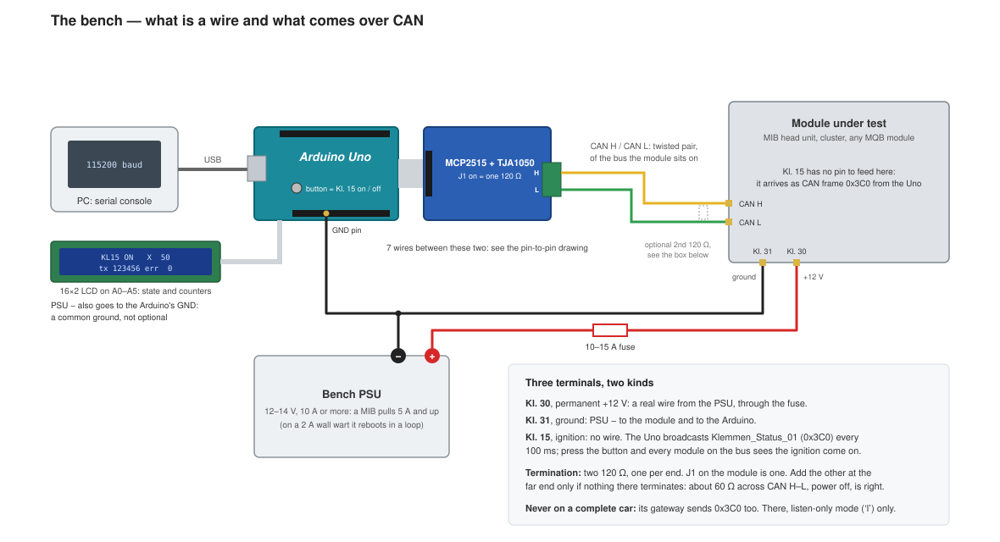
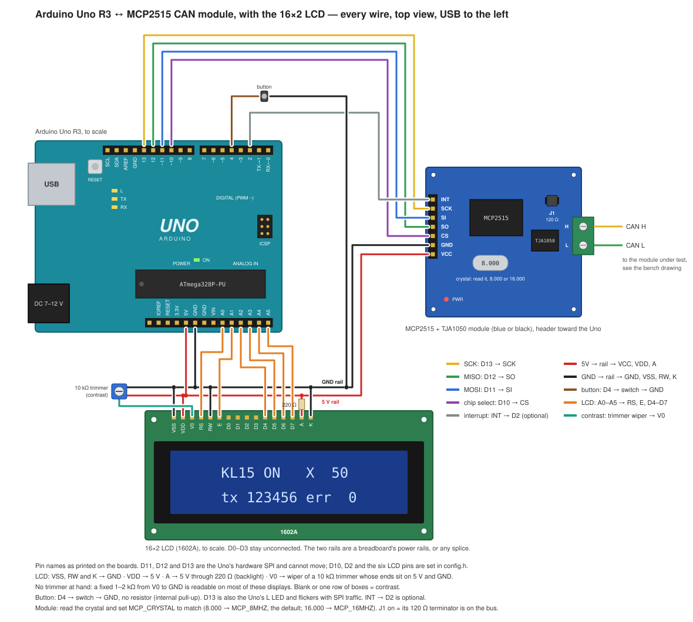
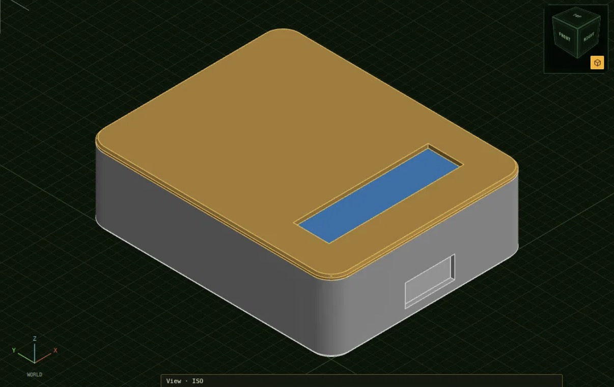
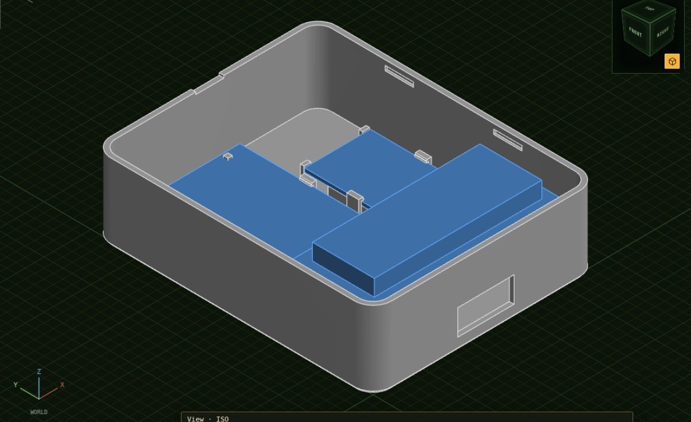
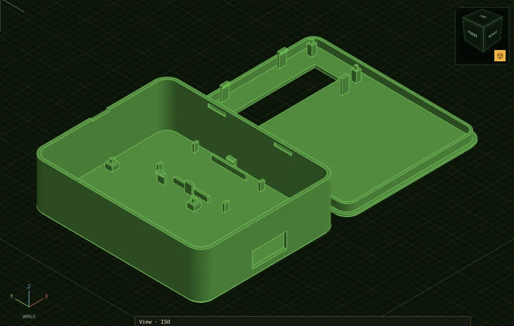
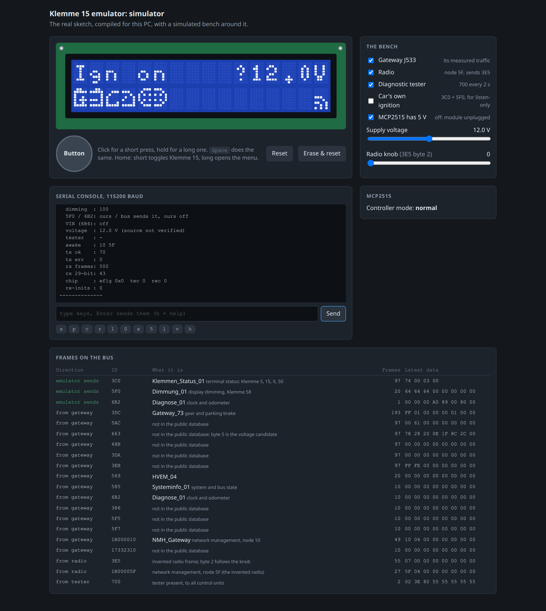

# VW MQB Ignition switch emulator (and few other things,too)

This project is based on Aliexpress MIB2/3 bench harness. it comes with gateway (low) a 12 V psu and som connectors. 

I've added 5 V psu, an USB block for 5F, a rail for easy tapping on to every CAN, LIN and power. Added few connector for different CU's as well. 

Arduino Uno + MCP2515. Sends the MQB ignition message (`Klemmen_Status_01`,
`0x3C0`) on CAN, 500 kbit/s. Ignition is switched with a push button or over
serial. A 16×2 LCD shows the state.



## Bench



| Part | Connects to |
|---|---|
| Emulator | Gateway convenience bus, pins 15 (H) / 5 (L) |
| OBD socket | Gateway diagnostic bus, pins 19 (H) / 9 (L) |
| Control unit under test | The gateway bus it uses in the car |
| USB module | Head unit, by USB data cable. +12 V, +5 V, ground |
| 12 V supply | Gateway pins 1–2 (+), 11–12 (−), and every unit |

Klemme 30 (+12 V) is a wire. Only Klemme 15 is sent over CAN.

Without a gateway the emulator goes straight on the module's CAN pair:



## Wiring



| Uno | Goes to |
|---|---|
| D13 | MCP2515 SCK |
| D12 | MCP2515 SO |
| D11 | MCP2515 SI |
| D10 | MCP2515 CS |
| D2 | MCP2515 INT |
| 5V, GND | MCP2515 VCC, GND |
| D4 | Push button to GND |
| A0, A1 | LCD RS, E |
| A2–A5 | LCD D4–D7 |

LCD: VSS, RW, K to GND. VDD to 5V. A to 5V through 220 Ω. V0 to a contrast trimmer.

Pins are set in [`config.h`](config.h).

## Messages sent

| ID | Name | Cycle | When |
|---|---|---|---|
| `0x3C0` | `Klemmen_Status_01` | 100 ms | Always |
| `0x5F0` | `Dimmung_01` | 500 ms | Ignition on, if no other node sends it |
| `0x6B2` | `Diagnose_01` | 1000 ms | Ignition on, if no other node sends it |
| `0x6B4` | `VIN_01` | 200 ms | After a VIN is typed on the console |

`0x3C0` checksum: CRC-8, polynomial `0x2F`, init `0xFF`, final XOR `0xFF`, over
bytes 1–3 and the constant `0xC3`.

## Build

1. Set `MCP_CRYSTAL` in [`config.h`](config.h) to the crystal on the MCP2515
   board: `MCP_8MHZ` (default) or `MCP_16MHZ`.
2. Install the libraries `MCP_CAN` (Cory J. Fowler) and `LiquidCrystal`.
3. Upload `can-emulator.ino`.
4. Serial console: 115200 baud.
5. Short press of the button, or `1` on the console: ignition on. Long press: menu.

## Button and menu

| Screen | Short press | Long press |
|---|---|---|
| Home | Ignition on / off | Open the menu |
| Menu | Next item | Act on the item |
| Bus monitor | Next ID | Back to the menu |

| Menu item | Long press |
|---|---|
| `Kl X` | Klemme X on / off |
| `Kl 50 crank` | Starter request while held. Needs ignition on |
| `Dimming` | +10 per step, 10–250 |
| `Clock hour` | +1 hour |
| `Clock minute` | +1 minute |
| `Bus monitor` | Opens the bus monitor |
| `Listen-only` | On / off |
| `Health` | Shows error counters |
| `Back` | Home screen |

Bus monitor pages: frames per second and ID count, units awake (network
management node addresses), then one page per ID with its interval and latest
data. A byte that changes blinks for 3 s.

## Case

Two printed parts, snap fit, no screws. 96 × 119.5 × 35 mm. Not printed yet.







Files in [`case/`](case/README.md):

| File | Contents |
|---|---|
| `can-emulator-case-print.3mf` | Base and lid on one bed |
| `can-emulator-case-base.stl` | Base |
| `can-emulator-case-lid.stl` | Lid |
| `can-emulator-case.sihicad.json` | HelCAD drawing |

## Simulator

The same sketch compiled for a PC, with the LCD in a browser.



```sh
./sim/run.sh        # http://127.0.0.1:8515/
```

## Tests

```sh
./check.sh        # host tests, AVR compile, simulator test
./test/run.sh     # host tests only
```

## Documentation

| Document | Contents |
|---|---|
| [docs/HARDWARE.md](docs/HARDWARE.md) | Parts, wiring, gateway pins, termination, power |
| [docs/USAGE.md](docs/USAGE.md) | Serial commands, menu, configuration, troubleshooting |
| [docs/PROTOCOL.md](docs/PROTOCOL.md) | Frame layouts, checksum |

## Safety

Do not send `0x3C0` into a complete car: the car's gateway already sends it.
On a car, use listen-only mode (`l` on the console).

## Sources

- [Ross-Tech forum thread 5918](https://forums.ross-tech.com/index.php?threads/5918/page-10)
- [`vw_mqb.dbc`](https://github.com/commaai/opendbc/blob/master/opendbc/dbc/vw_mqb.dbc), commaai/opendbc
- [`mqbcan.py`](https://github.com/commaai/opendbc/blob/master/opendbc/car/volkswagen/mqbcan.py), commaai/opendbc

Not affiliated with Volkswagen AG.

## License

MIT, see [LICENSE](LICENSE).
