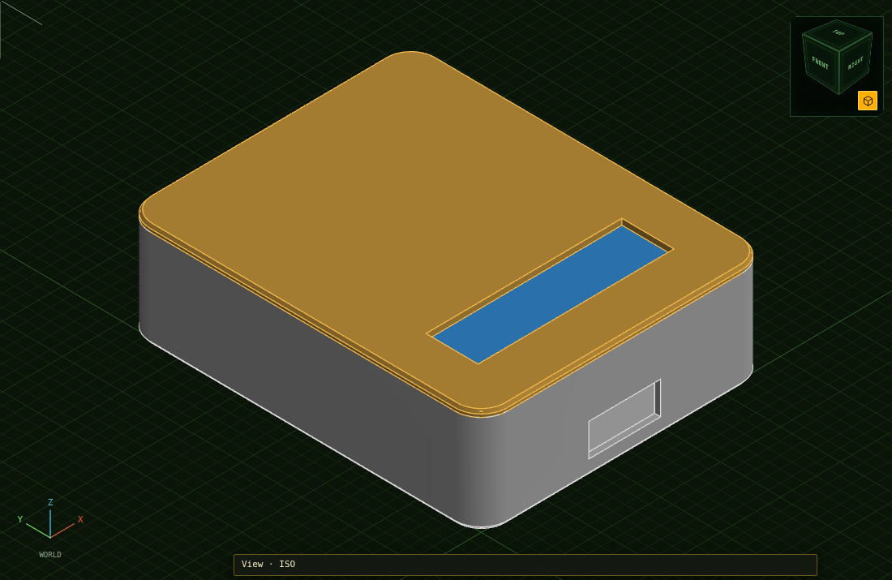
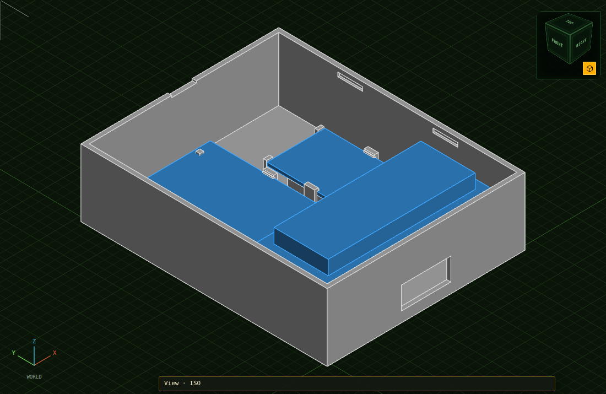

# VW MQB Klemme 15 emulator

Arduino Uno + MCP2515 firmware that broadcasts the VW MQB `Klemmen_Status_01`
CAN frame, so modules on a bench harness believe the ignition is on without a
body control module, steering column module (J527) or immobiliser present.

Ignition is toggled with a push button on the Arduino or over a serial console,
and a 16×2 LCD shows the state and the counters. Holding the button opens a
menu on the LCD: the other terminals, dimming, the clock, a bus monitor and
listen-only mode, all without a laptop. The bus monitor also lists which
units are awake and has a learning view that shows which byte of a message
reacts to what you do. A built-in sniffer, with a
listen-only mode that transmits nothing, lets you capture what a real car sends
and check your assumptions against it.


The build on the bench, sending ignition on to a J533 gateway: Uno clone at the
top, the MCP2515 module with the CAN pair on its screw terminal at the right,
the LCD and its contrast potentiometer at the bottom.

## The bench it belongs to

The emulator is one part of a bench built around a real **J533 gateway**. The
gateway stays on the bench permanently: it is what makes the OBD socket work,
so a diagnostic tester can reach, code and flash the control units hung on its
buses, and it is the one unit that has to believe the ignition is on. The
emulator supplies that ignition on the gateway's convenience bus.


| Part | Connects to | Why it is there |
|---|---|---|
| Klemme 15 emulator | Convenience bus, gateway pins 15 (high) / 5 (low) | Ignition on and off over CAN |
| OBD socket | Diagnostic bus, pins 19 (high) / 9 (low) | Where ODIS, VCDS or a flasher plugs in |
| Control unit under test | The bus it sits on in the car | Reached from the OBD socket through the gateway |
| 12 V supply | Gateway pins 1–2 (+), 11–12 (−), and every unit | Klemme 30 and 31 cannot be emulated |

The emulator remembers the ignition state across resets and power cuts, so a
bench that was on comes back on.

Checked on this bench with ODIS: *Terminal 15 status via CAN* reads on and off
as the button is pressed. Pins, power and what the gateway itself sends are in
[HARDWARE.md](docs/HARDWARE.md#the-bench-with-a-gateway).

A single module can also be driven without a gateway, the emulator straight on
the module's CAN pair:

```
   ┌─────────┐  SPI   ┌──────────┐  CAN   ┌──────────────────┐
   │ Arduino ├───────►│ MCP2515  ├───────►│ module under test│
   │   Uno   │        │ +TJA1050 │        │  (MIB, cluster…) │
   └────┬────┘        └──────────┘        └────────┬─────────┘
        │ button = Klemme 15                       │ Klemme 30
     ───┴───                                   ────┴──── 12 V PSU
```

## Documentation

| Document | Contents |
|---|---|
| [docs/HARDWARE.md](docs/HARDWARE.md) | Bill of materials, wiring drawings, termination, grounding, J533 pins, powering the module, safety |
| [docs/USAGE.md](docs/USAGE.md) | Toolchain setup, serial commands, workflows, configuration, troubleshooting |
| [docs/PROTOCOL.md](docs/PROTOCOL.md) | Frame layouts, checksum algorithm and how it was derived, adding messages |

## Klemme 30 vs Klemme 15 — read this first

These are not the same kind of thing, and only one of them is a CAN signal:

| Terminal | What it is | How you provide it |
|---|---|---|
| **Kl. 30** | Permanent battery +12 V, always live | **Physical wiring only.** There is no CAN signal for it — you must actually feed 12 V to the module. |
| **Kl. 15** | "Ignition on" | On MQB the BCM generates the physical T15 rail, but modules act on the **CAN broadcast**. That is what this project sends. |

So: **supply Kl. 30 from a bench PSU, emulate Kl. 15 with this sketch.** Most
MQB modules will not power up on the CAN message alone.

## Wiring

Two boards, a push button and a 16×2 LCD. The drawings show the real boards:
an Arduino Uno R3, to scale with the USB to the left; the common MCP2515 +
TJA1050 module — the blue "NiRen" one or the black one, which share the 7-pin
header `INT SCK SI SO CS GND VCC` and the 2-pin `CAN H` / `CAN L` screw
terminal; and the plain 16-pin 1602A display hanging from the analog header.


| Wire | Uno pin | Module pin | What it is |
|---|---|---|---|
| yellow | D13 (SCK) | SCK | SPI clock. D13 is also the Uno's `L` LED, so it flickers with traffic: normal. |
| green | D12 (MISO) | SO | SPI data, module → Uno |
| blue | D11 (MOSI) | SI | SPI data, Uno → module |
| violet | D10 | CS | chip select, `MCP_CS_PIN` |
| grey | D2 | INT | interrupt, wired for later. The sketch polls, so it works without it. |
| red | 5V | VCC | the module runs on 5 V |
| black | GND | GND | |
| brown | D4 | — | push button to GND. No resistor: the sketch enables the internal pull-up. |
| orange | A0–A5 | — | 16×2 LCD: A0 → RS, A1 → E, A2–A5 → D4–D7. On the LCD, VSS, RW and K → GND; VDD → 5V; A → 5V via 220 Ω; V0 → contrast trimmer; D0–D3 open. |

D11, D12 and D13 are the Uno's hardware SPI pins and cannot be moved; D10, D2
and the LCD pins are `MCP_CS_PIN`, `MCP_INT_PIN` and `LCD_*_PIN` in
[`config.h`](config.h). The LCD is optional (`ENABLE_LCD 0` without one). It
shows `Ign on` or `Ign off` and the supply voltage on its first line, and on
its second three icons — a car battery for Klemme 30, an instrument cluster
for 58 and a diagnostic socket for a tester — with a radio wave in the corner
that keeps waving while the traffic is alive.
The LCD's and the module's 5 V and GND all come from the Uno's one 5V pin and
its GND pins: share them with a breadboard rail or a splitter. Two things to
check on the module before the first upload: the **crystal** (`8.000` →
`MCP_8MHZ`, the default; `16.000` → `MCP_16MHZ`) and the **J1 jumper**, which
puts the module's own 120 Ω terminator on the bus.

The CAN pair from the module's screw terminal goes to the gateway's
convenience bus, as in the drawing under
[The bench it belongs to](#the-bench-it-belongs-to). Without a gateway it goes
straight to the module under test:


On the 12 V side, for that direct case:

1. **Kl. 30**: PSU + → 10–15 A fuse → the module's permanent-supply pin.
2. **Kl. 31**: PSU − → the module's ground pin **and** the Arduino's GND. CAN
   is differential but still ground-referenced; a floating Arduino gives
   intermittent, baffling errors.
3. **CAN H / CAN L**: from the module's screw terminal to the CAN pins of the
   bus the module under test sits on, as a twisted pair. Which bus, and the
   J533 gateway pins if your harness ends there: see
   [HARDWARE.md](docs/HARDWARE.md#connecting-to-the-vehicle-bus).
4. **Termination**: a bus needs two 120 Ω, one at each end. J1 on the MCP2515
   module is one; add the other at the far end only if nothing there
   terminates. About 60 Ω across CAN H–L with the power off is right.
5. **Kl. 15** has no wire. Press the button and it arrives as `0x3C0`.

## Messages sent

| ID | Name | DLC | Cycle | Purpose |
|---|---|---|---|---|
| `0x3C0` | `Klemmen_Status_01` | 4 | 100 ms | Terminal status (S, 15, X, 50). Always sent. |
| `0x5F0` | `Dimmung_01` | 8 | 500 ms | Display/panel dimming. Sent while Kl. 15 on, unless another node sends it. |
| `0x6B2` | `Diagnose_01` | 8 | 1000 ms | Odometer + date/time (the MIB clock). Sent while Kl. 15 on, unless another node (a gateway) sends it. |
| `0x6B4` | `VIN_01` | 8 | 200 ms | The VIN, in three frames in turn. Only after a VIN has been typed on the console (`V`), and unless another node sends it. |

The two MIB support messages are switched off with `ENABLE_MIB_MESSAGES` in
`config.h`. Their cycle times are plausible defaults rather than measured
values — see [PROTOCOL.md](docs/PROTOCOL.md#cycle-times).

## The checksum

Byte 0 of `0x3C0` is **CRC-8, polynomial `0x2F`, init `0xFF`, no reflection,
final XOR `0xFF`**, over bytes 1–3 followed by the magic byte **`0xC3`**.

Published bench setups hardcode a 16-entry table of checksums instead. That
table only covers one terminal state — ignition permanently on. Deriving the
algorithm (all 16 published values reduce to the single magic byte `0xC3`) means
this project can also send a valid *ignition off* frame, and drive Klemme X and
Klemme 50. The derivation is written up in
[PROTOCOL.md](docs/PROTOCOL.md#how-the-magic-byte-was-determined).

## Quick start

1. Check the crystal on your MCP2515 board and set `MCP_CRYSTAL` in
   [`config.h`](config.h) to match. Ships configured for 8 MHz. **Getting this
   wrong is the most common failure** — init reports OK and nothing works.
2. Wire it up as drawn under [Wiring](#wiring): seven wires to the module, the
   button from D4 to GND, the LCD on A0–A5, and a common ground with the module
   under test.
3. Install the **MCP_CAN** library by Cory J. Fowler, and **LiquidCrystal** by
   Arduino for the display (the IDE ships it; arduino-cli needs
   `lib install LiquidCrystal`).
4. Upload `can-emulator.ino` and open the serial monitor at **115200 baud**. A
   CH340 clone is `/dev/ttyUSB0`, a genuine Uno `/dev/ttyACM0`.
5. Press the button, or send `1`, to switch Klemme 15 on; the LCD says
   `Ign on`. Hold the button for the menu: see
   [USAGE.md](docs/USAGE.md#the-button-and-the-menu).

## Case

A two-part printed case, drawn for [HelCAD](https://sihilisko.com/helcad/):
the boards and their wiring inside, the display's window the only thing on the
outside, one hole in the lower side for the CAN pair, the supply and the
button's wires. The lid and the boards snap in; there are no screws. It
measures 96 × 119.5 × 35 mm, with the corners rounded to 8.8 mm and a bevel
round the top and bottom edges.





The HelCAD drawing, the two STL files and the program that generates them are
in [`case/`](case/README.md). It has not been printed yet; that page lists
what to measure first.

## Simulator

The sketch also runs on a PC, with the LCD drawn in a browser and a simulated
bench around it:

```sh
./sim/run.sh        # then open http://127.0.0.1:8515/
```

It is the real `can-emulator.ino`, compiled for the PC against stand-ins for
the Arduino core, the MCP2515, the LCD and the EEPROM. The page has the
button (click for a short press, hold for a long one), the serial console, and
switches for what is on the bus: the gateway with its measured traffic, a
radio, a diagnostic tester, a supply-voltage slider. See
[USAGE.md](docs/USAGE.md#the-simulator).

## Tests

```sh
./check.sh        # host tests + a real AVR compile
./test/run.sh     # host tests only, no toolchain needed
```

Host-side, no hardware needed. Checks the checksum against 16 reference values
captured from a real gateway, round-trips every `Dimmung_01` and `Diagnose_01`
signal through the bit packer, verifies maxed-out fields don't bleed into
their neighbours, and checks where each VIN character lands in `VIN_01`. The same checksum self-test also runs on the Arduino at boot.

## Layout

```
check.sh             host tests, AVR compile, simulator screen test: run this to verify a change
can-emulator.ino     scheduler, button and menu, LCD, serial console, sniffer, MCP2515 setup
config.h             all pin, timing and bitrate constants
mqb_klemmen.{h,cpp}  Klemmen_Status_01 (0x3C0) and the checksum
mqb_mib.{h,cpp}      Dimmung_01, Diagnose_01, generic little-endian bit packer
mqb_vin.{h,cpp}      VIN_01 (0x6B4), the VIN in three frames
test/                host test harness with an Arduino.h shim
sim/                 the simulator: the sketch on a PC, the LCD in a browser
case/                the printed case: HelCAD drawing, STL files, generator
docs/                hardware, usage and protocol documentation
docs/img/            the wiring drawings (SVG), the bench photo, pictures of the case
```

The `mqb_*` files are free of Arduino dependencies so they stay host-testable.

## Safety

Do **not** inject `0x3C0` into a complete, running vehicle — the real gateway
already transmits that ID, and two nodes sending the same ID with different
payloads causes error frames and can bus-off nodes. On a real car, send `l`
first: listen-only mode, in which the board neither transmits nor acknowledges
and only sniffs. Full notes in
[HARDWARE.md](docs/HARDWARE.md#safety-and-legal-notes).

## Sources

- [Ross-Tech forum thread 5918](https://forums.ross-tech.com/index.php?threads/5918/page-10)
  — frame layout and reference checksums.
- [`vw_mqb.dbc`](https://github.com/commaai/opendbc/blob/master/opendbc/dbc/vw_mqb.dbc)
  — signal definitions, from commaai/opendbc.
- [commaai/opendbc's VW checksum](https://github.com/commaai/opendbc/blob/master/opendbc/car/volkswagen/mqbcan.py)
  — arrives at the same magic byte `0xC3` for `0x3C0` independently, and its
  tests carry the same 16 reference frames.

Not affiliated with or endorsed by Volkswagen AG. "MQB", "MIB" and VW part
designations are used descriptively.

## License

MIT — see [LICENSE](LICENSE).
