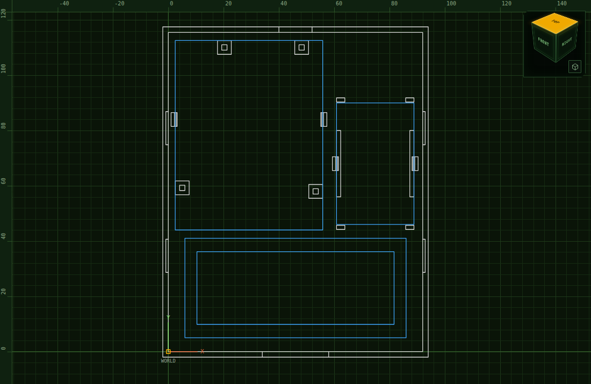
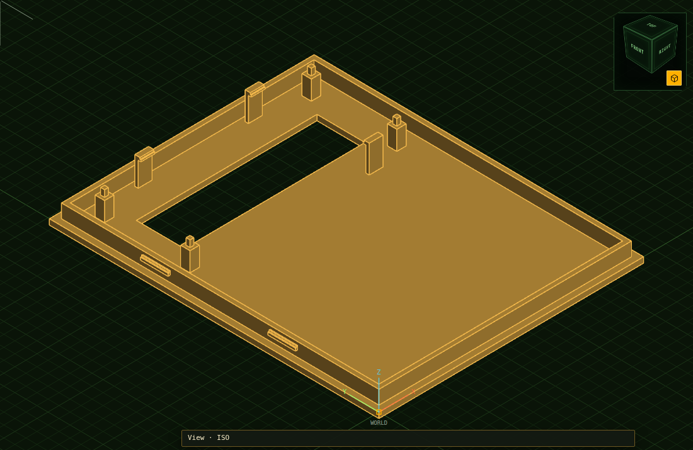

# The case

A two-part printed case for the emulator: the Uno, the MCP2515 module, the
display and the wires between them inside, the display's window the only thing
on the outside, and one hole in the lower side for the CAN pair, the supply and
the button's wires. No screws: the lid snaps onto the base, and the boards snap
onto their posts.

It is drawn for [HelCAD](https://sihilisko.com/helcad/). The drawing in this
folder opens in it as it is; the pictures here were taken in a local build of
HelCAD with that file open.


**This has not been printed yet.** Every number below comes from a drawing or a
data sheet, not from a part held against a caliper, and the three checks under
[Before you print](#before-you-print) are there for that reason.

## What is here

| File | What it is |
|---|---|
| `can-emulator-case.sihicad.json` | The HelCAD drawing: base, lid and the three boards as blocks, assembled. Layers `Case base`, `Case lid` and `Boards`; switch the lid's off to look inside. |
| `can-emulator-case-base.stl` | The base as it lies on the printer bed |
| `can-emulator-case-lid.stl` | The lid, turned outside-down for printing |
| `can-emulator-case-base.sihicad.json`, `…-lid.sihicad.json` | The same two parts, each as a drawing of its own |
| `gen/` | The program that writes all of the above from the numbers at its top |

Outside it measures **96 × 119.5 × 35 mm**; inside 92 × 115.5 × 31 mm. The base
is 49 cm³ of plastic, the lid 25 cm³.

## The layout



The lower side — the wall under the display, with the cable hole — is at the
bottom of the plan.

- **The display** hangs from the lid over the first 41 mm, above the space the
  cables come into. Nothing tall stands under it.
- **The Uno** lies behind it on four posts, turned so that its USB socket
  faces the cable space and its power and analog headers face the CAN module.
- **The CAN module** lies beside the Uno with its screw terminal toward the
  cable space, so the CAN pair runs straight to the hole.
- Behind the CAN module is a free corner of 28 × 23 mm for the contrast
  potentiometer and the splices.

### Why it is 35 mm high

The height is set by one stack and nothing else:

| | mm |
|---|---|
| Floor | 2.0 |
| Posts under the Uno | 3.5 |
| The Uno's board | 1.6 |
| A pin socket | 8.5 |
| A Dupont plug standing in it | 14.0 |
| Room for the wire to turn | 3.4 |
| Lid | 2.0 |
| | **35.0** |

Two thirds of the inside height is the plug and the socket. Solder the wires to
the Uno, or use angled plugs, and `UnoStack` in `gen/Program.cs` can come down
from 25.9. The next thing in the way is then the USB plug, which lies under
the display's wiring: `UnoStack` can go down to 17, a case 27 mm high, before
the two meet. Feed the Uno through wires instead of the USB plug (set
`UsbPlugAbove` to 0) and about 12 will do, which is 22 mm. The generator
refuses a height at which the plug and the display's wiring would meet.

## The numbers it is built on

| Part | Taken as | From |
|---|---|---|
| Arduino Uno R3 | Board 68.58 × 53.34 mm; four 3.2 mm holes at (13.97, 2.54), (15.24, 50.80), (66.04, 7.62), (66.04, 35.56) from the corner by the DC jack; USB socket centred 38.1 mm up that edge | Arduino's own board file for the Uno Rev3 (`arduino_Uno_Rev3-02-TH.brd`), read directly |
| 1602A display | Board 80.0 × 36.0 × 1.6 mm; four 2.5 mm holes 75.0 × 31.0 apart; viewing area 64.5 × 16.4; frame 71.3 × 26.3, its front 7.0 above the board's face; sixteen pins at 2.54, the first 8.0 from the left edge, 2.5 from the top | The outline drawing in the Xiamen Amotec ADM1602K specification, the common 1602 module |
| MCP2515 + TJA1050 module | Board 44 × 28 mm | Sellers disagree: one page gives 44 × 28, Components101 "about 40 × 28", and the module in the bench photo scales to about 44. **Measure yours.** |
| Dupont plug, pin socket | 14.0 and 8.5 mm tall | Common figures, not looked up for this build |
| USB-C plug | 6.5 mm thick, its top 4.85 mm above the board it is plugged into | The usual overmould; not measured |

A clone of the Uno keeps the holes where they are, which is what lets it take
shields. Where exactly its USB-C socket sits does not matter here: the plug is
inside the case and the cable bends to it.

## How it holds together

- **Lid to base.** A rim under the lid goes 5 mm down inside the walls. On each
  long side it has two ridges that snap into grooves in the walls. A slot in
  the top of the back wall, 12 × 1 mm, takes a flat screwdriver to open it.
- **Uno.** A post with a square pin under each of the four mounting holes, and
  a hook over each long edge.
- **CAN module.** Held by its edges only, so that the uncertain hole pattern
  does not matter: a rail under each long edge, a stop at each corner, a hook
  over each long edge.
- **Display.** Four posts with pins hang from the lid at the mounting holes,
  and three hooks catch the back of the board. The frame's front comes to rest
  against the inside of the lid; the window shows the viewing area and half a
  millimetre around it, so the frame itself is hidden.

Pins are square because the parts are made of boxes only. A pin's diagonal is
half a millimetre less than the hole. Every hook's lip, and every ridge, is in
two steps with the shallower one leading, which is the nearest a box comes to
a chamfer.



## Before you print

1. **Measure the CAN module's board.** If it is not 44 × 28 mm, change
   `McpLength` and `McpWidth` in `gen/Program.cs` and run the generator again.
2. **Look at which side of the display its pins are on.** The lid sits 7 mm in
   front of the display's board. A header soldered with its pins to the
   front, as the one in the bench photo is, cannot stay: the pins have to
   leave from the back, and to stay clear of the USB plug below they have to
   lie flat against the board, pointing down the display — an angled header,
   or the wires soldered straight on.
3. **Try the USB-C plug in a 24 × 11 mm opening.** That is the cable hole; the
   plug goes through it and into the Uno, 44 mm inside.

## Printing

- **Base:** floor down. **Lid:** outside down, as its STL lies. Nothing needs
  support.
- What a slicer will call overhangs are all bridges of a millimetre or less —
  the hooks' lips, the ridges, the tops of the grooves — except the top of the
  cable hole, a 24 mm bridge across a 2 mm wall. HelCAD's print check counts
  111 mm² of them on the base and 47 mm² on the lid.
- The hooks are 1.2 mm strips that bend by 0.7 mm. PETG takes that better than
  PLA, which may crack there after a few uses.
- 0.3 mm of air is left round every board (`Fit`), 0.2 mm between rim and wall.
  A printer that prints tight needs more.

## Putting it together

1. Wire everything on the bench first and see it run.
2. Press the display onto the lid's posts from behind until the three hooks
   catch.
3. Lead the CAN pair, the button's wires and the USB cable in through the
   hole.
4. Press the Uno onto its pins, USB socket toward the hole, then the CAN
   module between its hooks, screw terminal toward the hole.
5. Plug the USB cable in, lay the spare wire in the corner behind the CAN
   module, and press the lid on until both sides click.

## Changing it

Everything is a number at the top of `gen/Program.cs`. The generator uses
HelCAD's own code for the drawing, the STL files and the print check, so it
needs the `sihilisko-cad` repository next to this one and the .NET 10 SDK:

```sh
cd case/gen
dotnet run -c Release
```

It writes the five files into this folder and checks its own work: that each
part is closed, that its triangles enclose exactly the volume of its boxes,
that no board touches the case anywhere but at its pins, that the lid and the
base do not overlap, and that the USB plug stays clear of the display's
wiring. It stops with the reason if any of that fails.

Both parts are boxes: one to start from, then boxes added and boxes cut away.
The generator works out their surface itself, exactly, and keeps the boxes in
the drawing as each solid's steps, so in HelCAD a post or a hook is still
there to be found. `dotnet run -c Release -- --compare` also puts the same
boxes through HelCAD's own boolean, one join at a time, and says how far it
gets: the base goes through whole and agrees to the cubic micron, the lid is
refused at its ninth box.
